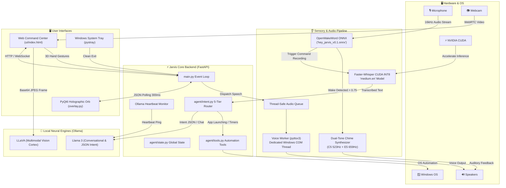
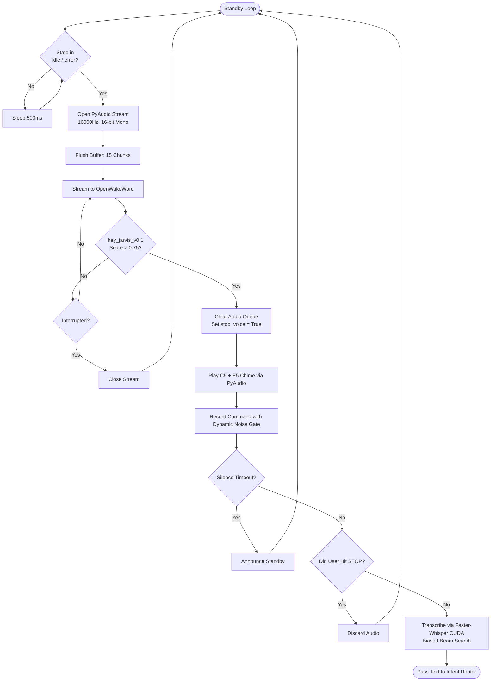
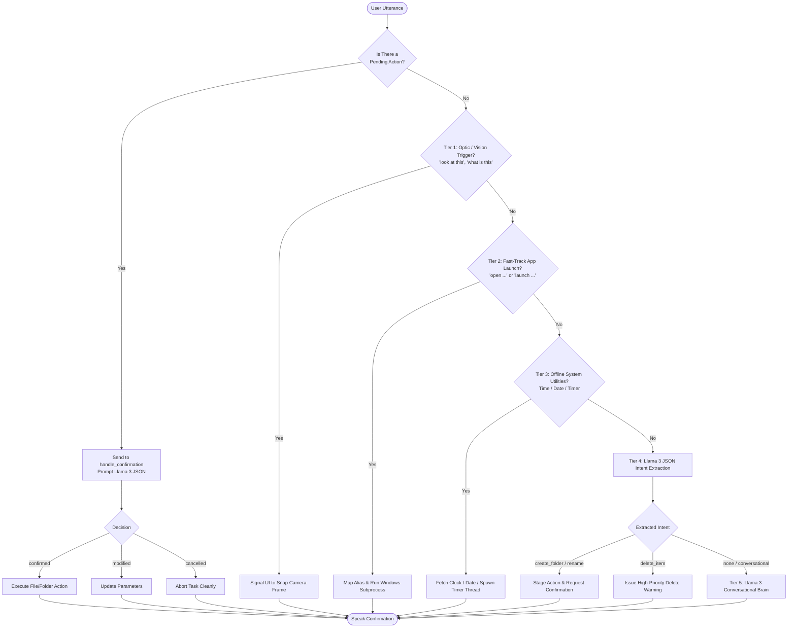
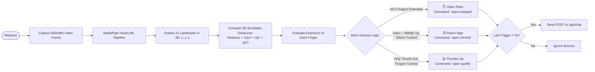
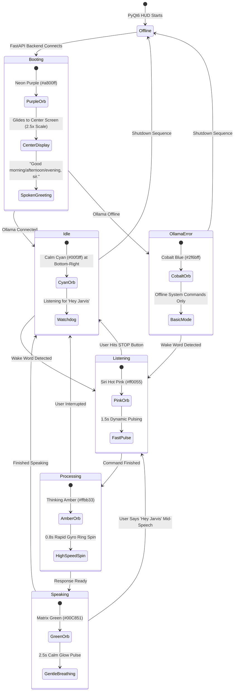

# ⚡ JARVIS CORE | Autonomous Desktop AI Assistant

<div align="center">

```
     ██╗ █████╗ ██████╗ ██╗   ██╗██╗███████╗     ██████╗ ██████╗ ██████╗ ███████╗
     ██║██╔══██╗██╔══██╗██║   ██║██║██╔════╝    ██╔════╝██╔═══██╗██╔══██╗██╔════╝
     ██║███████║██████╔╝██║   ██║██║███████╗    ██║     ██║   ██║██████╔╝█████╗  
██   ██║██╔══██║██╔══██╗╚██╗ ██╔╝██║╚════██║    ██║     ██║   ██║██╔══██╗██╔══╝  
╚█████╔╝██║  ██║██║  ██║ ╚████╔╝ ██║███████║    ╚██████╗╚██████╔╝██║  ██║███████╗
 ╚════╝ ╚═╝  ╚═╝╚═╝  ╚═╝  ╚═══╝  ╚═╝╚══════╝     ╚═════╝ ╚═════╝ ╚═╝  ╚═╝╚══════╝
```

### *Autonomous • 100% Local • Multimodal • Voice & 3D Gesture Driven • Windows OS*

[](https://www.python.org/)
[](https://fastapi.tiangolo.com/)
[](https://ollama.com/)
[](https://github.com/SYSTRAN/faster-whisper)
[](https://github.com/dscripka/openWakeWord)
[](https://www.riverbankcomputing.com/software/pyqt/)
[](https://developers.google.com/mediapipe)
[](https://www.microsoft.com/windows)

<p align="center">
  <b>Designed & Built by <a href="https://github.com/Parth-Chavan-15">Parth Chavan</a></b>
</p>

---

[⚡ Quick Start](#-quick-start-run-in-4-steps) • 
[✨ Features](#-key-features) • 
[🖐️ 3D Gestures](#-3d-hand-gestures-cheat-sheet) • 
[🗣️ Voice Commands](#-voice-commands-cheat-sheet) • 
[🔮 Holographic HUD](#-holographic-hud-state-guide) • 
[📊 Architecture & Flowcharts](#-system-architecture--expandable-flowcharts) • 
[⚙️ Full Setup](#-detailed-installation-guide) • 
[🧪 Diagnostics](#-hardware-diagnostics)

---

</div>

## 🌌 What is Jarvis Core?

**Jarvis Core** is an autonomous, multimodal, local-first personal desktop assistant inspired by Marvel's JARVIS. Built from scratch specifically for **Windows**, it runs entirely on your own computer with **zero cloud dependencies** — keeping your voice, images, and data 100% private.

* **👂 Listens** continuously with near-zero CPU usage for *"Hey Jarvis"*, chiming back like Google Assistant.
* **🧠 Thinks** using local **Meta Llama 3** for conversations, intent extraction, and safety confirmations.
* **👁️ Sees** through your webcam using **LLaVA** to analyze what you hold or point to.
* **🖐️ Tracks 3D Gestures** with **MediaPipe Hands** to launch apps via contactless hand signs.
* **🗣️ Speaks** with a thread-safe Windows COM voice pipeline that can be interrupted mid-sentence.
* **🔮 Holographic HUD** floats a futuristic, click-through 3D animated orb over your screen.

---

## ⚡ Quick Start (Run in 4 Steps)

> [!IMPORTANT]
> **Prerequisites:** Windows 10/11 and **Python 3.10** installed. (Python 3.10 ensures `PyAudio` installs effortlessly without requiring C++ build tools).

### 1. Download & Start Ollama
Install Ollama from [ollama.com](https://ollama.com/), open your terminal, and pull the two models:
```powershell
ollama pull llama3
ollama pull llava
```

### 2. Clone the Repository
```powershell
git clone https://github.com/Parth-Chavan-15/Jarvis_Core.git
cd Jarvis_Core
```

### 3. Create a Python 3.10 Virtual Environment & Install Dependencies
```powershell
py -3.10 -m venv venv
venv\Scripts\activate
pip install -r requirements.txt
```

### 4. Boot Up Jarvis
```powershell
python main.py
```
* **The Holographic HUD Orb** will glide to the center of your monitor, greet you verbally, and settle into the bottom-right corner.
* **Open your browser** to `http://127.0.0.1:8000` to open the Command Center and activate your webcam!

---

## ✨ Key Features

| Capability | What It Does | Technology Under the Hood |
| :--- | :--- | :--- |
| **Instant Wake Word** | Responds instantly to *"Hey Jarvis"* with a synthetic acoustic double-chime (C5 + E5). | OpenWakeWord ONNX (`hey_jarvis_v0.1.onnx`) |
| **Neural Speech-to-Text** | Blazing-fast GPU-accelerated voice transcription with command-biased beam search. | Faster-Whisper (`medium.en` with CUDA INT8) |
| **Fast-Track App Launch** | Opens apps like VS Code, Chrome, Word, and Edge in under 15ms by bypassing the LLM. | Native Windows Subprocess + Aliases |
| **Safe OS Automation** | Creates folders, renames files, and requires verbal confirmation before deleting anything. | Llama 3 JSON Intent Extraction + Confirmation State Machine |
| **3D Contactless Gestures** | Open palm, peace sign, or thumbs up to launch Notepad, Chrome, or Spotify. | MediaPipe Hands 3D Euclidean Vectors |
| **Vision Analysis** | *"What am I holding?"* snaps a frame and describes real-world objects. | Local LLaVA Multimodal Vision Model |
| **Thread-Safe TTS** | Clear voice synthesis that stops the instant you press STOP or say *"Hey Jarvis"*. | pyttsx3 on dedicated `pythoncom` worker thread |
| **Self-Healing Watchdog** | Background monitor checks Ollama every 3s and notifies you if the neural brain drops or recovers. | Multi-threaded heartbeat watchdog |
| **Floating HUD Orb** | Transparent, click-through, 3D gyroscopic rotating orb reflecting live system state. | PyQt6 + QWebEngineView + Hardware-Accelerated CSS |

---

## 🖐️ 3D Hand Gestures Cheat Sheet

Show your hand to the Command Center camera (`http://127.0.0.1:8000`). Jarvis computes 3D Euclidean distances ($\sqrt{\Delta x^2 + \Delta y^2 + \Delta z^2}$) across 21 hand joints to detect gestures with high precision:

| Gesture | Sign | What You Do | Executed Action | Cooldown |
| :---: | :---: | :--- | :--- | :---: |
| **Open Palm** | 🖐️ | Extend all 5 fingers facing the camera | **Opens Notepad** (`open notepad`) | 5 sec |
| **Peace Sign** | ✌️ | Extend Index + Middle fingers (tuck Thumb, Ring, Pinky) | **Opens Google Chrome** (`open chrome`) | 5 sec |
| **Thumbs Up** | 👍 | Clench all 4 fingers into a fist with Thumb pointed out | **Opens Spotify** (`open spotify`) | 5 sec |

---

## 🗣️ Voice Commands Cheat Sheet

Say **"Hey Jarvis"**, wait for the double-chime, and speak naturally:

### 🚀 Launching Applications (Instant Fast-Track)
* *"Open Chrome"* / *"Launch VS Code"*
* *"Open Word"* / *"Launch PowerPoint"* / *"Open Excel"*
* *"Open Command Prompt"* / *"Launch Browser"*

### 📁 Managing Files & Directories (With Safe Confirmation)
* *"Create a folder named Project on my Desktop."*
* *"Make a new directory called Invoices in Documents."*
* *"Delete the folder Old_Data on my Desktop."* ➔ *(Jarvis asks: "WARNING: Are you absolutely sure?" before touching files!)*
* *"Rename Draft to Final on Desktop."*

### ⏰ Timers, System Time & Date (Works Offline)
* *"What is the time?"* ➔ *"The current system time is 08:30 PM."*
* *"What's today's date?"* ➔ *"Today is Friday, November 20, 2026."*
* *"Set a timer for 10 minutes."* ➔ Spawns a background timer and speaks an alert when finished without interrupting you.

### 👁️ Visual Inspection (Multimodal Vision)
* *"Look at this and tell me what it is."*
* *"What am I holding in my hand?"*
* *"Describe what you see."*

### 🛑 System Shutdown & Interrupts
* Say *"Shutdown Jarvis"* or *"Turn off core systems"* to gracefully close everything.
* Click the red **⏹ Stop Jarvis** button in the UI or say *"Hey Jarvis"* to immediately cut off speech.

---

## 🔮 Holographic HUD State Guide

The transparent holographic orb (`overlay.py`) floats in the corner of your screen, rotating with 3D gyroscopic rings. Its colors tell you exactly what Jarvis is doing:

| State | Orb Color | Meaning |
| :---: | :---: | :--- |
| **🟣 Booting** | `#a800ff` Neon Purple | System is starting up; orb expands to center screen and greets you. |
| **🩵 Idle** | `#00f3ff` Calm Cyan | Standing by, silently listening for *"Hey Jarvis"*. |
| **🩷 Listening** | `#ff0055` Siri Hot Pink | Microphone active; pulsing while recording your command. |
| **🟡 Processing** | `#ffbb33` Amber Yellow | Rapidly spinning while Faster-Whisper or Llama 3 processes your request. |
| **🟢 Speaking** | `#00C851` Matrix Green | Voice engine is speaking your answer. |
| **🔵 Ollama Error** | `#2f6bff` Cobalt Blue | Ollama is offline. Basic utilities (time, app launching) still work. |
| **🔴 Offline** | `#ff3333` Red | Jarvis server (`main.py`) is stopped. |

---

## 📊 System Architecture & Expandable Flowcharts

Jarvis Core is designed as an asynchronous, decoupled system. Click any flowchart below to explore the internal logic:

<br>

<details>
<summary><b>📐 [FLOWCHART 1] Full System Architecture & Component Topology (Click to Expand)</b></summary>
<br>



</details>

<br>

<details>
<summary><b>🎙️ [FLOWCHART 2] Wake-Word & Audio Recording Pipeline (Click to Expand)</b></summary>
<br>



</details>

<br>

<details>
<summary><b>🔀 [FLOWCHART 3] 5-Tier Intent Routing & Confirmation Engine (Click to Expand)</b></summary>
<br>



</details>

<br>

<details>
<summary><b>🖐️ [FLOWCHART 4] 3D Spatial Computer Vision & Gesture Recognition (Click to Expand)</b></summary>
<br>



</details>

<br>

<details>
<summary><b>🗣️ [FLOWCHART 5] Immortal Audio Pipeline & Word-Level Interruption (Click to Expand)</b></summary>
<br>

```mermaid
flowchart TD
    INIT([App Boot]) --> COM_THREAD[Spawn Background Daemon Thread\nCall pythoncom.CoInitialize]
    COM_THREAD --> QUEUE_WAIT[Wait for Text in audio_queue]

    DISPATCH_CALL([speak_text Called]) --> PUT_QUEUE[audio_queue.put text]
    PUT_QUEUE --> QUEUE_WAIT

    QUEUE_WAIT --> DEQUEUE[Get Message & Set state = 'speaking']
    DEQUEUE --> FRESH_ENGINE[Initialize Fresh pyttsx3.init Engine\n(Prevents Windows Driver Memory Leaks)]
    FRESH_ENGINE --> HOOK[Attach 'started-word' Callback]
    HOOK --> RUN[engine.say & engine.runAndWait]

    subgraph WordCallback ["Real-Time Word Boundary Hook"]
        WORD[On Every Word Boundary] --> CHECK_KILL{Is stop_voice\n== True?}
        CHECK_KILL -- Yes --> ENGINE_STOP[engine.stop Immediately Truncates Audio]
        CHECK_KILL -- No --> NEXT_WORD[Continue Speaking]
    end

    HOOK -.-> WORD
    RUN --> CLEANUP[Call 'del engine' to Free Handles]
    CLEANUP --> STATE_RESET[Restore state = idle / ollama_error]
    STATE_RESET --> QUEUE_WAIT
```

</details>

<br>

<details>
<summary><b>🔮 [FLOWCHART 6] Holographic HUD Lifecycle & State Machine (Click to Expand)</b></summary>
<br>



</details>

---

## ⚙️ Detailed Installation Guide

### System Requirements
* **OS:** Windows 10 or 11 (64-bit).
* **Python:** **Python 3.10** *(Crucial: PyAudio C-bindings are pre-compiled for 3.10).*
* **GPU:** NVIDIA GPU with CUDA drivers recommended (runs on CPU fallback if needed).
* **Peripherals:** Microphone, webcam, and speakers/headphones.

---

### Step 1: Install Ollama & Pull Local Models
1. Download from [ollama.com](https://ollama.com/) and run the installer.
2. In your terminal, pull the language and vision models:
   ```powershell
   ollama pull llama3
   ollama pull llava
   ```
3. Test that Ollama is responding:
   ```powershell
   curl http://127.0.0.1:11434/
   # Returns: "Ollama is running"
   ```

---

### Step 2: Clone the Project
```powershell
git clone https://github.com/Parth-Chavan-15/Jarvis_Core.git
cd Jarvis_Core
```

---

### Step 3: Setup the Python 3.10 Environment
Make sure you use **Python 3.10**:
```powershell
# Create virtual environment
py -3.10 -m venv venv

# Activate it
venv\Scripts\activate

# Upgrade pip
pip install --upgrade pip

# Install dependencies
pip install -r requirements.txt
```

> [!TIP]
> If `pip install -r requirements.txt` throws an error on `pyaudio`, simply run:
> ```powershell
> pip install pipwin
> pipwin install pyaudio
> ```

---

### Step 4: Run Hardware Diagnostics
Before launching, verify your microphone and acoustic model:

```powershell
# Diagnostic 1: Tests your microphone hardware & checks background noise
python test_mic.py

# Diagnostic 2: Verifies 'Hey Jarvis' wake word & Faster-Whisper transcription
python test_ears.py
```

---

### Step 5: Start Jarvis
```powershell
python main.py
```
Open **`http://127.0.0.1:8000`** in your browser to access the live Command Center!

---

## 🧪 Hardware Diagnostics

Jarvis Core includes two built-in diagnostics to isolate audio and model issues:

### 1. `test_mic.py` (Hardware Diagnostic)
Scans connected audio devices, calibrates ambient noise for 2 seconds, captures 5 seconds of audio, and reports the exact byte count captured to confirm your mic is operating properly.

```powershell
python test_mic.py
```

### 2. `test_ears.py` (Wake-Word Diagnostic)
Tests the acoustic model (`hey_jarvis_v0.1.onnx`) without launching the FastAPI server. Say *"Hey Jarvis"*, listen for the chime, speak a test command, and verify Faster-Whisper's transcription accuracy in your console.

```powershell
python test_ears.py
```

---

## 📡 REST API Documentation

The FastAPI server runs locally on `http://127.0.0.1:8000`:

| Endpoint | Method | Purpose | Sample Request Body |
| :--- | :---: | :--- | :--- |
| **`/api/chat`** | `POST` | Process a text command sequence. | `{"message": "Open Chrome"}` |
| **`/api/vision`** | `POST` | Send a camera frame snapshot to LLaVA. | `{"prompt": "What is this?", "image_b64": "data:image/jpeg;base64,..."}` |
| **`/api/vision_failed`**| `POST` | Notify backend if camera is frozen or minimized. | `{"error": "camera_frozen"}` |
| **`/api/status`** | `GET` | Polled by Web UI for logs, state, and camera requests. | *(None)* |
| **`/api/hud`** | `GET` | High-frequency endpoint polled by PyQt6 HUD. | *(None)* |
| **`/api/stop`** | `POST` | Global emergency kill switch (stops speech & LLM). | *(None)* |

---

## 📂 Project Directory Structure

```
Jarvis_Core/
│
├── agent/                         # Core Agent Intelligence
│   ├── __init__.py                # Package marker
│   ├── brain.py                   # Ollama Llama 3 conversational engine & streaming
│   ├── ears.py                    # OpenWakeWord ONNX watchdog & Faster-Whisper CUDA
│   ├── eyes.py                    # LLaVA multimodal vision processing
│   ├── intent.py                  # 5-Tier Intent routing & safety confirmations
│   ├── state.py                   # Global thread-safe state machine & interrupt flags
│   ├── tools.py                   # Windows filesystem automation, timers & app launcher
│   └── voice.py                   # Immortal Windows COM pyttsx3 audio worker
│
├── models/                        # Pre-Trained Machine Learning Models
│   └── hey_jarvis_v0.1.onnx       # Custom openWakeWord acoustic wake-word model
│
├── ui/                            # Cyberpunk Command Center Web App
│   └── index.html                 # MediaPipe 3D gesture tracking & WebRTC terminal
│
├── .gitignore                     # Git ignore rules
├── main.py                        # Central server, FastAPI endpoints, system tray, & lifecycle
├── overlay.py                     # PyQt6 hardware-accelerated holographic HUD orb
├── requirements.txt               # Locked production dependencies
├── test_ears.py                   # Standalone diagnostic for wake-word & Whisper
├── test_mic.py                    # Standalone diagnostic for audio input hardware
└── README.md                      # Project documentation
```

---

## 🛠️ Troubleshooting & FAQ

<details>
<summary><b>Q: Jarvis says "Sir, my neural engine is currently offline."</b></summary>
<br>

* Make sure Ollama is running. Open terminal and run `ollama serve`.
* Verify that you have pulled the model: `ollama pull llama3`.
* Jarvis continuously monitors port `11434`. The moment Ollama starts, Jarvis turns green and automatically announces: *"Connection to Ollama neural engine re-established."*

</details>

<details>
<summary><b>Q: Faster-Whisper throws a CUDA or cuDNN error.</b></summary>
<br>

* If you do not have an NVIDIA GPU, open `agent/ears.py` line 22 and change `device="cuda"` to `device="cpu"`:
  ```python
  whisper_model = WhisperModel("medium.en", device="cpu", compute_type="int8")
  ```

</details>

<details>
<summary><b>Q: Hand gestures aren't triggering.</b></summary>
<br>

* Check that your browser allowed camera permissions on `http://127.0.0.1:8000`.
* Ensure the Command Center tab is active and visible on your screen. If minimized for > 2 seconds, the camera heartbeat sleeps to save GPU cycles.
* Hold your hand clearly in front of the camera and pause for a moment to allow the 5-second debounce timer to reset.

</details>

<details>
<summary><b>Q: PyAudio fails during installation.</b></summary>
<br>

* Ensure you are running **Python 3.10**. Newer Python versions may lack pre-compiled binary wheels for PyAudio.
* Alternatively, install via pipwin:
  ```powershell
  pip install pipwin
  pipwin install pyaudio
  ```

</details>

---

## 👨‍💻 Author & Credits

**Jarvis Core** was designed, architected, and engineered by **[Parth Chavan](https://github.com/Parth-Chavan-15)**.

Special thanks to the open-source projects powering Jarvis:
* **[Ollama](https://ollama.com/)** for local LLM inference.
* **[Systran](https://github.com/SYSTRAN/faster-whisper)** for `faster-whisper`.
* **[David Scripka](https://github.com/dscripka/openWakeWord)** for `openWakeWord`.
* **[Google MediaPipe](https://developers.google.com/mediapipe)** for 3D real-time hand tracking.

---

<div align="center">

### ⭐ Star this repository on GitHub if you love local AI! ⭐

*Built with passion, local neural compute, and clean engineering.*

</div>
