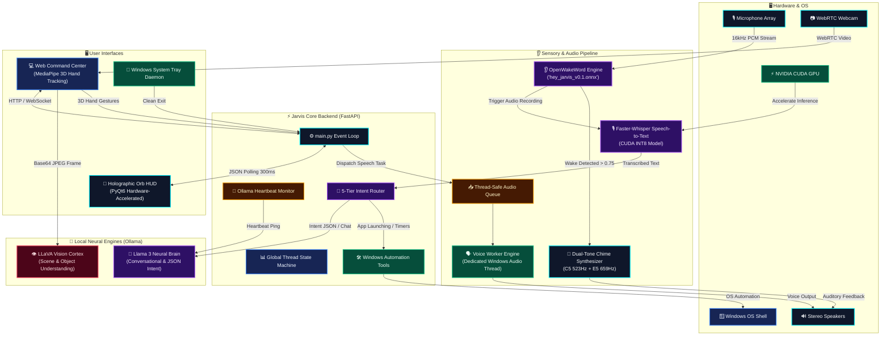
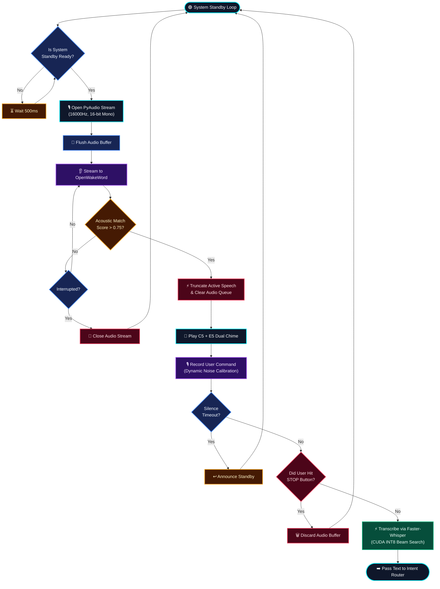
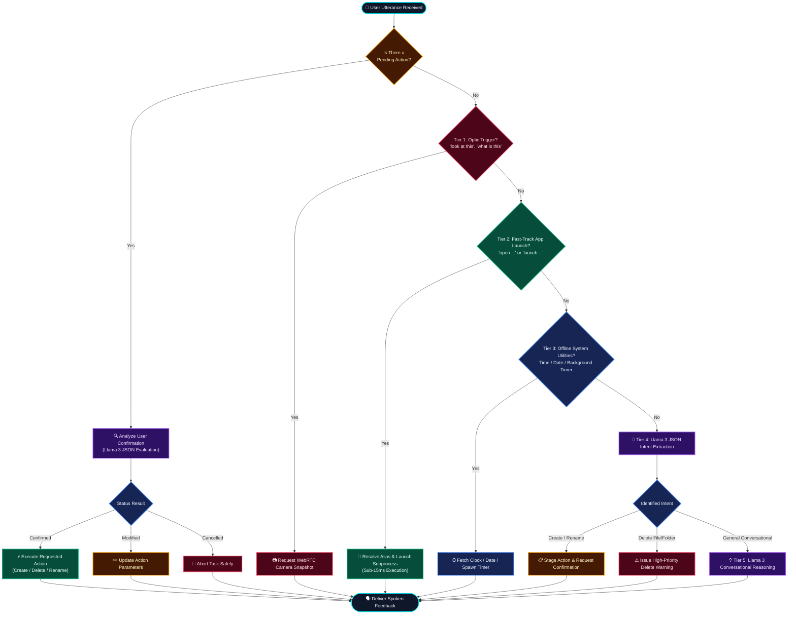
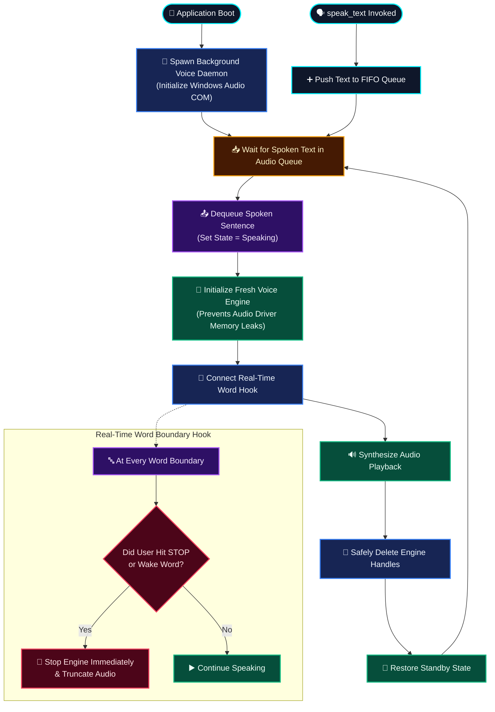
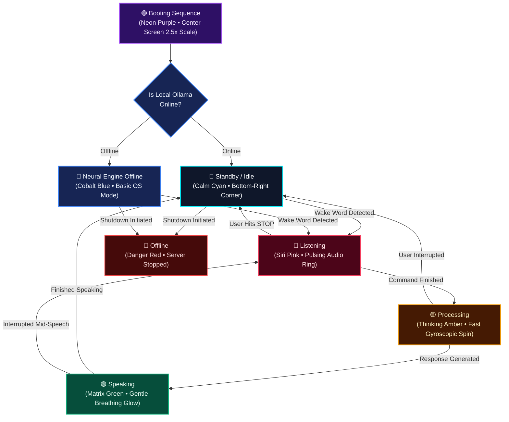

```mermaid
flowchart LR
    classDef cyan fill:#0f172a,stroke:#00f3ff,stroke-width:2px,color:#f8fafc;
    classDef purple fill:#2e1065,stroke:#a855f7,stroke-width:2px,color:#f3e8ff;
    classDef green fill:#064e3b,stroke:#10b981,stroke-width:2px,color:#ecfdf5;
    classDef amber fill:#451a03,stroke:#f59e0b,stroke-width:2px,color:#fef3c7;
    classDef pink fill:#4c0519,stroke:#f43f5e,stroke-width:2px,color:#ffe4e6;
    classDef blue fill:#172554,stroke:#3b82f6,stroke-width:2px,color:#eff6ff;

    CAM(["📷 WebRTC Webcam"]):::cyan --> FRAME["🎞️ Capture 640x480 Video Frame"]:::blue
    FRAME --> MP["🤖 MediaPipe Hands ML Model"]:::purple
    MP --> POINTS["📍 Extract 21 Landmarks in 3D Space"]:::cyan
    
    POINTS --> MATH["📐 Calculate 3D Euclidean Distances\nBetween Joints & Bases"]:::blue
    MATH --> FINGERS["🖐️ Evaluate Finger Extension States"]:::purple

    FINGERS --> LOGIC{"Strict Geometric\nGesture Classifier"}:::amber
    LOGIC -- All 5 Fingers Extended --> PALM["🖐️ Open Palm Detected\nCommand: 'open notepad'"]:::green
    LOGIC -- Index + Middle Extended --> PEACE["✌️ Peace Sign Detected\nCommand: 'open chrome'"]:::cyan
    LOGIC -- Thumb Out, Others Tucked --> THUMB["👍 Thumbs Up Detected\nCommand: 'open spotify'"]:::purple

    PALM --> COOLDOWN{"5-Second\nCooldown Check"}:::blue
    PEACE --> COOLDOWN
    THUMB --> COOLDOWN

    COOLDOWN -- Ready --> API["⚡ Forward Command to Backend"]:::green
    COOLDOWN -- Cooling Down --> SUPPRESS["🛡️ Suppress Duplicate Trigger"]:::pink
```

# ⚡ JARVIS CORE | Autonomous Desktop AI Assistant

<div align="center">

```
     ██╗ █████╗ ██████╗ ██╗   ██╗██╗███████╗     ██████╗ ██████╗ ██████╗ ███████╗
     ██║██╔══██╗██╔══██╗██║   ██║██║██╔════╝    ██╔════╝██╔═══██╗██╔══██╗██╔════╝
     ██║███████║██████╔╝██║   ██║██║███████╗    ██║     ██║   ██║██████╔╝█████╗  
██   ██║██╔══██║██╔══██╗╚██╗ ██╔╝██║╚════██║    ██║     ██║   ██║██╔══██╗██╔══╝  
╚█████╔╝██║  ██║██║  ██║ ╚████╔╝ ██║███████║    ╚██████╗╚██████╔╝██║  ██║███████╗
 ╚════╝ ╚═╝  ╚═╝╚═╝  ╚═╝  ╚═══╝  ╚═╝╚══════╝     ╚═════╝ ╚═════╝ ╚═╝  ╚═╝╚══════╝
```

### *Autonomous • 100% Local • Multimodal • Voice & 3D Gesture Driven • Windows OS*

[](https://www.python.org/)
[](https://fastapi.tiangolo.com/)
[](https://ollama.com/)
[](https://github.com/SYSTRAN/faster-whisper)
[](https://github.com/dscripka/openWakeWord)
[](https://www.riverbankcomputing.com/software/pyqt/)
[](https://developers.google.com/mediapipe)
[](https://www.microsoft.com/windows)

<p align="center">
  <b>Designed & Built by <a href="https://github.com/Parth-Chavan-15">Parth Chavan</a></b>
</p>

---

[⚡ Quick Start](#-quick-start-run-in-4-steps) • 
[✨ Features](#-key-features) • 
[🖐️ 3D Gestures](#-3d-hand-gestures) • 
[🗣️ Voice Commands](#-voice-commands-cheat-sheet) • 
[🔮 Holographic HUD](#-holographic-desktop-hud) • 
[📊 Architecture & Flowcharts](#-system-architecture--flowcharts) • 
[⚙️ Setup Guide](#-step-by-step-setup-guide) • 
[🛠️ FAQ](#-troubleshooting--faq)

---

</div>

## 🌌 What is Jarvis Core?

**Jarvis Core** is an autonomous, multimodal, local-first personal desktop assistant inspired by Marvel's JARVIS. Built from scratch specifically for **Windows**, it runs entirely on your own computer with **zero cloud dependencies** — keeping your voice, images, and data 100% private.

* **👂 Listens** continuously with near-zero CPU usage for *"Hey Jarvis"*, chiming back like Google Assistant.
* **🧠 Thinks** using local **Meta Llama 3** for conversations, intent extraction, and safety confirmations.
* **👁️ Sees** through your webcam using **LLaVA** to analyze what you hold or point to.
* **🖐️ Tracks 3D Gestures** with **MediaPipe Hands** to launch apps via contactless hand signs.
* **🗣️ Speaks** with a thread-safe Windows voice pipeline that can be interrupted mid-sentence.
* **🔮 Holographic HUD** floats a futuristic, click-through 3D animated orb over your screen.

---

## ⚡ Quick Start (Run in 4 Steps)

> [!IMPORTANT]
> **Prerequisites:** Windows 10/11 and **Python 3.10** installed. (Python 3.10 ensures audio drivers install cleanly without requiring Visual Studio C++ build tools).

### 1. Download & Start Ollama
Install Ollama from [ollama.com](https://ollama.com/), open your terminal, and pull the two models:
```powershell
ollama pull llama3
ollama pull llava
```

### 2. Clone the Repository
```powershell
git clone https://github.com/Parth-Chavan-15/Jarvis_Core.git
cd Jarvis_Core
```

### 3. Create a Python 3.10 Virtual Environment & Install Dependencies
```powershell
py -3.10 -m venv venv
venv\Scripts\activate
pip install -r requirements.txt
```

### 4. Boot Up Jarvis
```powershell
python main.py
```
* **The Holographic HUD Orb** will glide to the center of your monitor, greet you verbally, and settle into the bottom-right corner.
* **Open your browser** to `http://127.0.0.1:8000` to access the Command Center and activate your webcam!

---

## ✨ Key Features

| Capability | What It Does | Technology Under the Hood |
| :--- | :--- | :--- |
| **Instant Wake Word** | Responds instantly to *"Hey Jarvis"* with an acoustic dual-tone chime. | OpenWakeWord Neural ONNX Model |
| **Neural Speech-to-Text** | Blazing-fast GPU-accelerated voice transcription with command-biased search. | Faster-Whisper (CUDA INT8 Acceleration) |
| **Fast-Track App Launch** | Opens apps like VS Code, Chrome, Word, and Edge in under 15ms. | Native Windows Subprocess & Aliases |
| **Safe OS Automation** | Creates folders, renames files, and asks for confirmation before deleting anything. | Llama 3 JSON Extraction + Confirmation Logic |
| **3D Contactless Gestures** | Open palm, peace sign, or thumbs up to launch Notepad, Chrome, or Spotify. | MediaPipe Hands 3D Spatial Vector Analysis |
| **Vision Analysis** | *"What am I holding?"* snaps a frame and describes real-world objects. | Local LLaVA Multimodal Vision Model |
| **Thread-Safe TTS** | Clear voice synthesis that stops the instant you press STOP or speak. | pyttsx3 with Dedicated Windows Audio Thread |
| **Self-Healing Watchdog** | Background monitor checks Ollama every 3s and notifies you if the brain reconnects. | Multi-Threaded Heartbeat Monitor |
| **Floating HUD Orb** | Transparent, click-through, 3D gyroscopic rotating orb reflecting live system state. | PyQt6 + Hardware-Accelerated 3D CSS |

---

## 🖐️ 3D Hand Gestures

Show your hand to the Command Center camera (`http://127.0.0.1:8000`). Jarvis tracks 21 distinct joints in full 3D coordinate space, ensuring gestures trigger reliably regardless of hand angle:

| Gesture | Sign | What You Do | Executed Action | Cooldown |
| :---: | :---: | :--- | :--- | :---: |
| **Open Palm** | 🖐️ | Extend all 5 fingers facing the camera | **Opens Notepad** | 5 sec |
| **Peace Sign** | ✌️ | Extend Index + Middle fingers (tuck Thumb, Ring, Pinky) | **Opens Google Chrome** | 5 sec |
| **Thumbs Up** | 👍 | Clench fingers into a fist with Thumb pointed outward | **Opens Spotify** | 5 sec |

---

## 🗣️ Voice Commands Cheat Sheet

Say **"Hey Jarvis"**, wait for the double-chime, and speak naturally:

### 🚀 Launching Applications (Instant Fast-Track)
* *"Open Chrome"* / *"Launch VS Code"*
* *"Open Word"* / *"Launch PowerPoint"* / *"Open Excel"*
* *"Open Command Prompt"* / *"Launch Browser"*

### 📁 Managing Files & Directories (With Safe Confirmation)
* *"Create a folder named Project on my Desktop."*
* *"Make a new directory called Invoices in Documents."*
* *"Delete the folder Old_Data on my Desktop."* ➔ *(Jarvis asks: "WARNING: Are you absolutely sure?" before touching files!)*
* *"Rename Draft to Final on Desktop."*

### ⏰ Timers, System Time & Date (Works Offline)
* *"What is the time?"* ➔ *"The current system time is 08:30 PM."*
* *"What's today's date?"* ➔ *"Today is Friday, November 20, 2026."*
* *"Set a timer for 10 minutes."* ➔ Spawns a background timer and speaks an alert when finished without interrupting you.

### 👁️ Visual Inspection (Multimodal Vision)
* *"Look at this and tell me what it is."*
* *"What am I holding in my hand?"*
* *"Describe what you see."*

### 🛑 System Shutdown & Interrupts
* Say *"Shutdown Jarvis"* or *"Turn off core systems"* to gracefully close everything.
* Click the red **⏹ Stop Jarvis** button in the UI or say *"Hey Jarvis"* to immediately cut off speech.

---

## 🔮 Holographic Desktop HUD

The transparent holographic orb (`overlay.py`) floats above all open windows, rotating with 3D gyroscopic rings. Its colors reflect the live state of your AI assistant:

| Visual Glow | System State | Description |
| :---: | :---: | :--- |
| 🟣 **Neon Purple** | **Booting** | Startup sequence; the orb glides to the center of your screen and delivers a time-aware vocal greeting. |
| 🩵 **Calm Cyan** | **Standby (Idle)** | Standing by; silently monitoring the microphone array for *"Hey Jarvis"*. |
| 🩷 **Siri Pink** | **Listening** | Microphone is active and pulsating while capturing your voice command. |
| 🟡 **Thinking Amber** | **Processing** | Gyroscopic rings spin rapidly while Whisper transcribes and Llama 3 processes your request. |
| 🟢 **Matrix Green** | **Speaking** | Voice synthesis is active; delivering clear spoken responses. |
| 🔵 **Cobalt Blue** | **Neural Engine Offline** | Ollama is unreachable. Offline utilities (time, date, app launching) remain available. |
| 🔴 **Danger Red** | **Offline** | The Jarvis Core backend service is not running. |

---

## 📊 System Architecture & Flowcharts

Jarvis Core is designed as an asynchronous, decoupled system. Click any flowchart below to explore the internal logic:

<br>

<details>
<summary><b>📐 [FLOWCHART 1] Full System Architecture & Component Topology (Click to Expand)</b></summary>
<br>



</details>

<br>

<details>
<summary><b>🎙️ [FLOWCHART 2] Wake-Word & Audio Recording Pipeline (Click to Expand)</b></summary>
<br>



</details>

<br>

<details>
<summary><b>🔀 [FLOWCHART 3] 5-Tier Intent Routing & Confirmation Engine (Click to Expand)</b></summary>
<br>



</details>

<br>

<details>
<summary><b>🖐️ [FLOWCHART 4] 3D Spatial Computer Vision & Gesture Recognition (Click to Expand)</b></summary>
<br>



</details>

<br>

<details>
<summary><b>🗣️ [FLOWCHART 5] Immortal Audio Pipeline & Real-Time Interruption (Click to Expand)</b></summary>
<br>



</details>

<br>

<details>
<summary><b>🔮 [FLOWCHART 6] Holographic HUD Lifecycle & State Machine (Click to Expand)</b></summary>
<br>



</details>

---

## ⚙️ Step-by-Step Setup Guide

### System Requirements
* **OS:** Windows 10 or 11 (64-bit).
* **Python:** **Python 3.10** *(Crucial: PyAudio C-bindings install cleanly on Python 3.10).*
* **GPU:** NVIDIA GPU with CUDA drivers recommended (runs on CPU fallback if needed).
* **Peripherals:** Microphone, webcam, and speakers/headphones.

---

### Step 1: Install Ollama & Pull Local Models
1. Download from [ollama.com](https://ollama.com/) and run the installer.
2. In your terminal, pull the language and vision models:
   ```powershell
   ollama pull llama3
   ollama pull llava
   ```
3. Test that Ollama is responding:
   ```powershell
   curl http://127.0.0.1:11434/
   # Returns: "Ollama is running"
   ```

---

### Step 2: Clone the Project
```powershell
git clone https://github.com/Parth-Chavan-15/Jarvis_Core.git
cd Jarvis_Core
```

---

### Step 3: Setup the Python 3.10 Environment
Make sure you use **Python 3.10**:
```powershell
# Create virtual environment
py -3.10 -m venv venv

# Activate it
venv\Scripts\activate

# Upgrade pip
pip install --upgrade pip

# Install dependencies
pip install -r requirements.txt
```

> [!TIP]
> If `pip install -r requirements.txt` throws an error on `pyaudio`, simply run:
> ```powershell
> pip install pipwin
> pipwin install pyaudio
> ```

---

### Step 4: Quick Audio & Wake-Word Verification
Jarvis includes two quick diagnostic scripts to verify your microphone and speech models before launching the full app:

```powershell
# Test 1: Verify your microphone hardware & check ambient noise calibration
python test_mic.py
# Scans all audio input devices, measures room noise for 2 seconds, and confirms clean waveform capture.

# Test 2: Verify "Hey Jarvis" wake-word detection & Whisper transcription
python test_ears.py
# Runs the wake-word engine locally. Say "Hey Jarvis", listen for the double-chime, and speak a test command.
```

---

### Step 5: Start Jarvis
```powershell
python main.py
```
Open **`http://127.0.0.1:8000`** in your browser to access the live Command Center!

---

## 📂 Project Directory Structure

```
Jarvis_Core/
│
├── agent/                         # Core Agent Intelligence
│   ├── __init__.py                # Package marker
│   ├── brain.py                   # Ollama Llama 3 conversational engine & streaming
│   ├── ears.py                    # OpenWakeWord ONNX watchdog & Faster-Whisper CUDA
│   ├── eyes.py                    # LLaVA multimodal vision processing
│   ├── intent.py                  # 5-Tier Intent routing & safety confirmations
│   ├── state.py                   # Global thread-safe state machine & interrupt flags
│   ├── tools.py                   # Windows filesystem automation, timers & app launcher
│   └── voice.py                   # Dedicated Windows audio worker thread
│
├── models/                        # Pre-Trained Machine Learning Models
│   └── hey_jarvis_v0.1.onnx       # Custom openWakeWord acoustic wake-word model
│
├── ui/                            # Cyberpunk Command Center Web App
│   └── index.html                 # MediaPipe 3D gesture tracking & WebRTC terminal
│
├── .gitignore                     # Git ignore rules
├── main.py                        # Central server, FastAPI endpoints, system tray, & lifecycle
├── overlay.py                     # PyQt6 hardware-accelerated holographic HUD orb
├── requirements.txt               # Locked production dependencies
├── test_ears.py                   # Quick diagnostic for wake-word & Whisper
├── test_mic.py                    # Quick diagnostic for audio input hardware
└── README.md                      # Project documentation
```

---

## 🛠️ Troubleshooting & FAQ

<details>
<summary><b>Q: Jarvis says "Sir, my neural engine is currently offline."</b></summary>
<br>

* Make sure Ollama is running. Open terminal and run `ollama serve`.
* Verify that you have pulled the model: `ollama pull llama3`.
* Jarvis continuously monitors Ollama in the background. The moment Ollama starts, Jarvis turns green and automatically announces: *"Connection to Ollama neural engine re-established."*

</details>

<details>
<summary><b>Q: Faster-Whisper throws a CUDA or cuDNN error.</b></summary>
<br>

* If you do not have an NVIDIA GPU, set the device to CPU in `agent/ears.py`:
  ```python
  whisper_model = WhisperModel("medium.en", device="cpu", compute_type="int8")
  ```

</details>

<details>
<summary><b>Q: Hand gestures aren't triggering.</b></summary>
<br>

* Check that your browser allowed camera permissions on `http://127.0.0.1:8000`.
* Ensure the Command Center tab is active and visible on your screen. If minimized for more than 2 seconds, the camera heartbeat sleeps to save GPU cycles.
* Hold your hand clearly in front of the camera and pause for a moment to allow the 5-second debounce timer to reset.

</details>

<details>
<summary><b>Q: PyAudio fails during installation.</b></summary>
<br>

* Ensure you are running **Python 3.10**. Newer Python versions may lack pre-compiled binary wheels for PyAudio.
* Alternatively, install via pipwin:
  ```powershell
  pip install pipwin
  pipwin install pyaudio
  ```

</details>

---

## 👨‍💻 Author & Credits

**Jarvis Core** was designed, architected, and engineered by **[Parth Chavan](https://github.com/Parth-Chavan-15)**.

Special thanks to the open-source projects powering Jarvis:
* **[Ollama](https://ollama.com/)** for local LLM inference.
* **[Systran](https://github.com/SYSTRAN/faster-whisper)** for `faster-whisper`.
* **[David Scripka](https://github.com/dscripka/openWakeWord)** for `openWakeWord`.
* **[Google MediaPipe](https://developers.google.com/mediapipe)** for 3D real-time hand tracking.

---

<div align="center">

### 🌟 Loved Jarvis Core?

If this project inspired you or helped you explore local AI, feel free to give it a **Star**!

[⭐ Star on GitHub](https://github.com/Parth-Chavan-15/Jarvis_Core) • [🐛 Report an Issue](https://github.com/Parth-Chavan-15/Jarvis_Core/issues) • [💡 Suggest a Feature](https://github.com/Parth-Chavan-15/Jarvis_Core/pulls)

<br>

*“Sometimes you gotta run before you can walk.” — Tony Stark*

</div>
